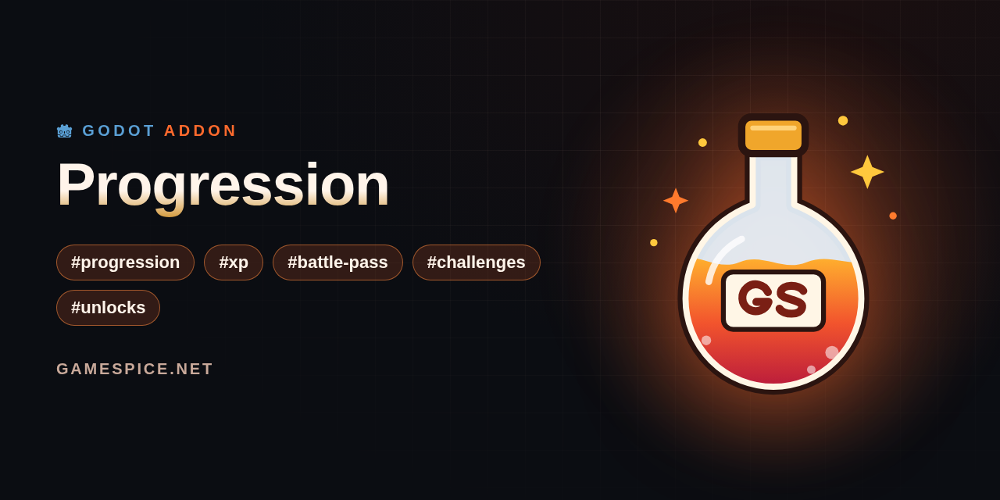

[](https://moddingcommunity.com/a/142-gs-progression)

Godot 4.7+ addon for XP, levels, season and battle-pass tracks, daily and weekly challenges and unlock tables as a bounded document a dedicated server can validate, reporting to the TMC backbone. Part of the [GameSpice](https://github.com/gamespice-platform) addon family. It needs only [GameSpice Core](https://github.com/gamespice-platform/core).

A player's progression is one small Dictionary (`xp` and the tiers claimed). Everything else is a pure function over it: the XP curve, level lookups, reward tracks and the daily or weekly challenge deal. Server and client compute the same answer, and a server needs no art loaded to check a claim.

`GSProgressionUnlocks` answers "what does this level open" from a `{id: level}` table. `GSProgression` is the live object for a HUD: it holds the state, emits `xp_changed`, `leveled_up` (with the ids the level-up unlocked) and `reward_claimed`, and hands the state to `to_dict()` / `load_dict()` so GameSpice Save or a server stores it. A flat curve (`growth` 1.0) is computed in closed form, so a huge grant never loops.

## Install

1. Copy `addons/dot_progression/` and `addons/dot_core/` into your project.
2. Enable dot-progression in *Project > Project Settings > Plugins*.

## Quick start

```gdscript
var cfg := GSProgressionConfig.from_files().value   # defaults, cfg/addon/dot_progression/*.yml, DOT_PROGRESSION_*, --progression-*
var state := GSProgressionState.create()            # {xp: 0, claimed: []}

var g := GSProgressionState.grant(cfg, state, 250)  # refuses negatives and anything over max_grant
if g.ok:
    state = g.value["state"]
    print(g.value["levels_gained"])

var track := GSProgressionTrack.from_dict({"id": "season1", "tiers": [
    {"level": 2, "reward": "spray_a"},
    {"level": 2, "reward": "skin_gold", "premium": true}]}).value
var claim := track.claim(cfg, state, 2, false, false)    # level, premium tier?, owns premium?
if claim.ok:
    state = claim.value["state"]                         # claim.value["reward"] is the id to grant

var dealt := GSProgressionChallenges.assign(cfg, pool, player_id, Time.get_unix_time_from_system(), "daily")
var rolled := GSProgressionChallenges.roll(held, dealt) # keeps progress inside a period, resets across one
```

`GSProgressionCurve.progress(cfg, xp)` gives `{level, into, needed, fraction}` for a progress bar.

## Settings

Every number is a field on `GSProgressionConfig`. A zero in a limit means unlimited. Ranges are inspector slider limits, not enforced caps.

| Setting | Default | What it does |
| --- | --- | --- |
| `enabled` | true | Off, grants fail with a state error. |
| `base_xp` | 100 | XP from level 1 to level 2. |
| `growth` | 1.15 | Each level costs this many times the one before. |
| `max_level` | 0 | Top level; 0 is unlimited. |
| `max_grant` | 0 | Largest single grant a server accepts; 0 is unlimited. |
| `daily_count` | 3 | Daily challenges dealt; 0 deals the whole pool. |
| `weekly_count` | 3 | Weekly challenges dealt; 0 deals the whole pool. |
| `day_seconds` | 86400 | Length of a daily period. |
| `week_seconds` | 604800 | Length of a weekly period. |
| `reset_offset_seconds` | 0 | Shifts the reset moment. |

## What it is not

- Not achievements: GameSpice Achievements holds one-off goals as rules over stats. Progression is the ongoing level, season and challenge loop.
- Not statistics: GameSpice Stats counts what happened. Progression turns grants into levels.
- Not a store or a currency: GameSpice Store sells things and GameSpice Economy runs round-based buy money. A track only names the reward id; granting it is the game's.
- Not storage: keep the state document with GameSpice Save or your own backend.

## Test

```bash
godot --headless --path . --import
godot --headless --path . res://examples/progression_selftest.tscn
```

The self-test is offline and exits non-zero on any failure.

## Status

Built and maintained with Claude Code. The test suites pass, but little of this has been in front of real players yet. Please report rough edges by opening an issue.

## Licence

MIT. See [LICENSE](LICENSE). Only the TMC back-end web infrastructure is not open source.
